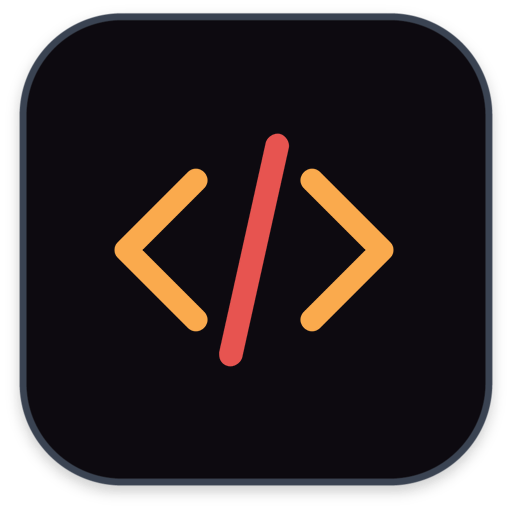

#  3rdparty #

3rdparty builds libraries and tools for color, film, and 3D applications on macOS and Windows, including OpenUSD, MaterialX, rendering, visualization, and digital content workflows.


The project began as a manually maintained collection of third-party library builds. Today, it is an agent-driven build framework maintained and tested with Codex. Package versions, platform settings, source patches, and installed outputs are defined in the repository so changes can be reviewed and validated with fresh builds. Shared recipes keep the platforms aligned while preserving the settings each library needs.

## Contents ##

- [ 3rdparty](#-3rdparty)
  - [Contents](#contents)
  - [Overview](#overview)
  - [Building 3rdparty](#building-3rdparty)
    - [Build on macOS](#build-on-macos)
      - [macOS prerequisites](#macos-prerequisites)
      - [Build all libraries](#build-all-libraries)
      - [Build a selected library](#build-a-selected-library)
      - [macOS SDK shell](#macos-sdk-shell)
      - [Qt compiler compatibility](#qt-compiler-compatibility)
      - [Debug Qt with 3rdparty](#debug-qt-with-3rdparty)
      - [Deploy with 3rdparty](#deploy-with-3rdparty)
    - [Build on Windows](#build-on-windows)
      - [Windows prerequisites](#windows-prerequisites)
      - [Windows build commands](#windows-build-commands)
      - [Windows Security and Qt Multimedia](#windows-security-and-qt-multimedia)
      - [Windows SDK shell](#windows-sdk-shell)
  - [Advanced configuration](#advanced-configuration)
    - [CMake configuration](#cmake-configuration)
    - [Package configuration](#package-configuration)
  - [Tested on](#tested-on)
  - [GitHub](#github)
  - [Contact](#contact)
  - [License](#license)

## Overview ##

3rdparty provides a curated set of libraries commonly used in film, color science, and image processing, with scripts and CMake recipes for building them from source. It gives you control over dependency versions, configuration flags, platform compatibility patches, and installation paths.

You can build the full SDK or select a library and its prerequisites, test new package versions, and customize builds for your applications. Debug and Release installations use separate prefixes, keeping their libraries and Python extensions together.

The project is intended for developers who need control over how their dependencies are built, particularly in VFX pipelines and specialized media tools. It complements package managers such as Homebrew and MacPorts rather than replacing them.

Package versions and source-specific changes are recorded in [packages.txt](packages.txt). Instructions for maintaining recipes and validating changes are in [AGENTS.md](AGENTS.md).

## Building 3rdparty ##

Run `build.sh` on macOS or `build.bat` on Windows from the repository root.
Both launch the shared `build.py` driver, which configures CMake and invokes
its build targets directly. CMake projects use Ninja. Autotools and native
Make projects retain their package-specific build commands.

Choose `debug`, `release`, or `all` explicitly; `all` builds both configurations.
A full build runs base dependencies, Qt, then libraries and extras, stopping if
any stage fails. Use `--project <target>` for a selected library and its declared
prerequisites, `--base-only` for base dependencies, or `--build-dir <path>` for
an alternate build root. Run the platform launcher with `--help` for options.

### Build on macOS ###

#### macOS prerequisites ####

Install [CMake](https://cmake.org/) 3.27 or newer, Xcode with its command-line
tools, and Python 3.9 or newer with development headers and libraries. Git and
curl must also be available. `build.sh` checks the standard CMake application
location at `/Applications/CMake.app/Contents/bin` if CMake is not on `PATH`.

For direct CMake commands outside the launcher, add it to your shell if needed:

```shell
export PATH="$PATH:/Applications/CMake.app/Contents/bin"
```

You do not need to install Ninja separately on macOS. The driver bootstraps the
existing Ninja package with CMake's Unix Makefiles generator and the Make/compiler
tools supplied by Xcode, then uses Ninja for the SDK's CMake builds. This host
tool is kept in `build/tools`, separate from the SDK prefixes. An external
Ninja on `PATH` can also be used.

Before compiling, the driver checks the Python modules needed by the selected
build. A full Mac build requires NumPy, PyOpenGL, Jinja2, setuptools, and
`typing_extensions` for Python older than 3.11. Missing modules are reported
with an install command for the interpreter running the driver.

CMake uses that same interpreter and `FindPython3` to select matching development
files. For direct CMake configuration, select an interpreter with
`-DPython3_EXECUTABLE=/path/to/python3`.

#### Build all libraries ####

To build the full SDK, including Qt 6.10.1, for macOS 12 and newer:

```shell
./build.sh all --target 12
```

The deployment target defaults to macOS 12 and can be changed with `--target`.
To build one configuration or resume an interrupted build:

```shell
./build.sh debug --target 12
./build.sh release --target 12
```

The install prefixes are `build/macosx/<architecture>.debug` and `.release`,
using the host architecture, such as `arm64` on Apple Silicon. Qt sources and
its normal build trees are stored under `qt`.

For a full `all` build, an interactive terminal prompts before removing an
existing build root. Answering yes removes installed dependencies too; Qt
source and build trees under `qt` remain. Answering no resumes the existing
build. Non-interactive runs keep the build root. Single-configuration, selected,
and base-only builds do not prompt to clean.

Use a fresh build root when changing CMake generators or toolchains. The driver
does not convert existing caches. For an isolated build, use:

```shell
./build.sh all --build-dir build-validation --target 12
```

An alternate build root also keeps Qt's build trees inside the selected SDK
prefixes, separate from the normal Qt builds. The downloaded Qt source remains
shared under `qt`.

Qt uses Ninja Multi-Config and installs both framework configurations and its
Release tools into each Mac prefix. The driver selects tool and package search
paths for each configuration so a Debug shell does not select Debug dependencies
for a Release build.

To build only base dependencies or Qt and its prerequisites:

```shell
./build.sh all --base-only --target 12
./build.sh all --project qt --target 12
```

#### Build a selected library ####

Use `--project` with the library's CMake target name, for example:

```shell
./build.sh debug --project openexr --target 12
./build.sh release --project openexr --target 12
./build.sh all --project openexr --target 12
```

Replace `openexr` with another target, such as `ocio` or `opentimelineio`.
CMake resolves the declared prerequisites; unrelated libraries and the Qt build
stage are skipped. Selected builds use the normal SDK prefixes unless you pass
`--build-dir`, and do not prompt to clean.

For libraries that consume Qt, such as PySide or OpenUSD, build Qt in the same
build root first. A selected library build does not install Qt automatically.

#### macOS SDK shell ####

After building packages into the default build root, double-click
`tools/3rdparty-shell.command` to open a Terminal window for Debug. From an
existing terminal, start a child shell with:

```shell
./tools/3rdparty-shell.sh debug
./tools/3rdparty-shell.sh release
```

The shell opens at the repository root with the selected
`build/macosx/<architecture>.debug` or `.release` prefix. It sets `PATH`,
`CMAKE_PREFIX_PATH`, `PKG_CONFIG_PATH`, and the Python module paths for that SDK.
It also selects the active Xcode SDK as `SDKROOT` and restores the SDK's recorded
macOS deployment target. Both `python` and `python3` use the interpreter recorded
in its CMake cache. `THIRDPARTY_PREFIX` and `THIRDPARTY_PYTHON` identify the
selected SDK and Python.

Commands become available as their packages are built. For example:

```shell
python -c "import opentimelineio; print(opentimelineio.__file__)"
python -c "from pxr import Usd; print(Usd.Stage.CreateInMemory())"
usdcat --help
ninja --version
```

The launcher starts zsh without user startup files so they cannot replace the
SDK paths. Type `exit` to return to the previous shell. Starting Release from
inside a Debug SDK shell restores the original base paths before selecting
Release. A missing prefix or configured interpreter is reported; the shell
does not build packages automatically.

The shell clears inherited `DYLD_*` path overrides and `DYLD_IMAGE_SUFFIX` so
runtime loading follows the SDK's installed Mach-O paths. To select Qt's Debug
framework variants, use the instructions below.

#### Qt compiler compatibility ####

The Mac driver applies `src/scripts/patch_qt.py` to fresh and reused Qt 6.10.1
source trees. The patch includes `<arm_acle.h>` on ARM so AppleClang 21 can compile
Qt's `__yield()` intrinsic. It is safe to repeat manually:

```shell
python3 src/scripts/patch_qt.py qt/qt-everywhere-src-6.10.1
```

Qt is configured with `FEATURE_dup3=OFF` so its child processes work on macOS
versions before 27. Reused Qt build trees are reconfigured. Qt's default Ninja
Multi-Config build/install targets include both framework configurations and
Release tools. PySide uses the installed Clang for header discovery. The Mac
driver exports the active Xcode SDK as `SDKROOT`.

#### Debug Qt with 3rdparty ####

When using a Qt framework containing a `_debug` binary, set `DYLD_IMAGE_SUFFIX`
to `_debug` to load it. The selected framework must contain that binary; a
directory named `arm64.debug` alone does not establish its build configuration.
Inside the Debug SDK shell, check QtCore before setting it:

```shell
test -f "$THIRDPARTY_PREFIX/lib/QtCore.framework/Versions/A/QtCore_debug" &&
    export DYLD_IMAGE_SUFFIX=_debug
```

Use `unset DYLD_IMAGE_SUFFIX` for normal Release framework loading. For CMake
consumers, also select `CMAKE_BUILD_TYPE=Debug` or `Release` so Qt's imported
targets select the matching libraries. With a multi-config generator, select
the configuration at build time with `--config Debug` or `--config Release`.

#### Deploy with 3rdparty ####

Mac libraries are installed with absolute install names and dependency paths
pointing to the selected SDK prefix. An application still needs a deployment
step to collect its frameworks, libraries, plug-ins, and resources and rewrite
runtime paths for its bundle.

For a Qt application, run the selected SDK's `macdeployqt` or an equivalent
packaging tool, then include any additional application dependencies:

```shell
macdeployqt /path/to/MyApp.app
otool -L /path/to/MyApp.app/Contents/MacOS/MyApp
```

Check that non-system runtime dependencies resolve within the application
bundle through `@rpath`, `@executable_path`, or `@loader_path`, rather than the
build SDK. Complete application signing after deployment has finished.

### Build on Windows ###

#### Windows prerequisites ####

Install Visual Studio or Visual Studio Build Tools with the MSVC x64 C++ tools,
[CMake](https://cmake.org/) 3.27 or newer, Ninja, Git, and curl. The command-line
tools must be available on `PATH` after the Visual Studio environment is set up.

Download the **Windows x86-64 executable installer** from the
[Python 3.9.0 release page](https://www.python.org/downloads/release/python-390/).
Choose **Customize installation**, then enable **Download debugging symbols**
and **Download debug binaries (requires VS 2017 or later)** under
**Advanced Options**. Keep the developer headers and libraries enabled. The
debug binaries include `python_d.exe`, `python39_d.dll`, and the
`libs\python39_d.lib` import library needed for native Debug Python builds.

`build.bat` selects Python 3.9 through `py.exe -3.9`, the standard per-user
installation, or a Python 3.9 interpreter on `PATH`.

A full Windows build or an OpenUSD-only build checks for PyOpenGL (imported
as `OpenGL`) and Jinja2 (imported as `jinja2`) before starting. OpenUSD uses
PyOpenGL for `usdview` and Jinja2 for schema generation tools. Install the
packages with the interpreter for each configuration you plan to build. To
prepare both configurations in PowerShell, run:

```powershell
$python39 = py.exe -3.9 -c "import sys; print(sys.base_prefix)"
& (Join-Path $python39 'python.exe') -m pip install PyOpenGL Jinja2
& (Join-Path $python39 'python_d.exe') -m pip install PyOpenGL Jinja2
```

If you use a Python installation without `py.exe`, set `$python39` to its
installation directory. Qt-only, base-only, and other selected library builds
can run without these two packages. OpenEXR's Python module also requires NumPy
for the selected interpreter.

#### Windows build commands ####

Run `build.bat` from a regular Command Prompt. It locates Visual Studio and sets
up the x64 build environment before starting the driver. An existing x64
developer prompt also works.

```bat
build.bat all
build.bat debug
build.bat release
build.bat all --base-only
build.bat debug --project qt
build.bat debug --project boost
```

The SDK prefixes are `build\win\x64.debug` and `build\win\x64.release`.
Use `--build-dir` to choose a different build root. A full interactive
`build.bat all` prompts before removing an existing build root and keeps it
by default. Non-interactive, single-configuration, selected, and base-only
builds reuse existing outputs without prompting.

`--project qt` builds the Qt prerequisites and Qt. Other selected targets build
only their CMake prerequisites. For PySide or OpenUSD, install Qt with the same
configuration and build root first. The Debug Qt prefix includes the Release
Qt tools, including `moc.exe`. Windows Qt Multimedia uses the native Windows
backend. The Windows ports of FFmpeg, x264, OpenCV, and NanoGUI are pending;
Autotools recipes run only on Unix.

Use the selected prefix as `CMAKE_PREFIX_PATH` for consumers, and add its `bin`
directory to `PATH` when running programs linked to its DLLs. Boost, Ptex, and
OpenUSD install DLLs under `lib`, so add that directory too. Each prefix also
contains headers, import libraries, and CMake and pkg-config metadata.

Use `python_d.exe` with extensions from the Debug prefix and `python.exe` with
extensions from the Release prefix. When importing extensions directly, use
`os.add_dll_directory()` with the absolute paths of the prefix's runtime DLL
directories.

#### Windows Security and Qt Multimedia ####

Smart App Control can block a locally built Qt DLL during shader generation.
On the Windows 11 26H2 test machine, `qsb.exe --version` returned
`0xC0E90002`, and Windows recorded Code Integrity event `3077` for
`Qt6Gui.dll`. Check **Event Viewer → Applications and Services Logs →
Microsoft → Windows → CodeIntegrity → Operational** for the blocked file.
[Microsoft’s Code Integrity event reference](https://learn.microsoft.com/en-us/windows/security/application-security/application-control/app-control-for-business/operations/event-id-explanations)

For a temporary local test, open **Windows Security → App & browser control →
Smart App Control settings** and select **Off**. This setting applies system-wide.
Run `build.bat debug --project qt` to resume the Debug Qt build, then return
to the same settings and select **On** after the test. Recent Windows updates
support re-enabling Smart App Control without reinstalling Windows.
[Microsoft’s Smart App Control FAQ](https://support.microsoft.com/en-us/windows/security/threat-malware-protection/smart-app-control-frequently-asked-questions)

#### Windows SDK shell ####

After building packages into the default build root, double-click
`tools\3rdparty-shell.bat` to open a new Command Prompt for the Debug SDK.
For Release, run `tools\3rdparty-shell.bat release`.

The shell opens at the repository root with the selected prefix's executables
and DLLs on `PATH` and its Python modules registered. `python` starts the
matching Python 3.9 interpreter. For example:

```bat
python -c "from pxr import Usd; print(Usd.Stage.CreateInMemory())"
usdcat --help
ninja --version
```

Use `call python` inside batch files, or invoke `"%THIRDPARTY_PYTHON%"`
directly to use the selected Python executable. Commands and modules are
available once their packages have been built into that prefix.

## Advanced configuration ##

### CMake configuration ###

The launchers are the normal build entry points. For direct CMake configuration,
see `CMakeLists.txt` for package and group options. Use Ninja and keep separate
build/install directories for each platform, architecture, and configuration.

Direct commands require CMake and Ninja on `PATH` and the platform's compiler
environment. On macOS, provide the Xcode SDK and deployment-target environment
normally set by `build.py`. On Windows, run inside an x64 Visual Studio developer
prompt. Direct dependency targets do not run the driver's Qt build stage.

Use the selected SDK prefix as `CMAKE_PREFIX_PATH` when configuring consumers.
The SDK shells above set this automatically.

### Package configuration ###

Individual packages can be disabled with CMake cache options, for example
`-Dlibpng=OFF`. Enabled packages require their dependency targets: enable the
corresponding groups (`build_base`, `build_libs`, `build_extras`) and package
options, or disable the dependent package. Configuration reports missing targets.
The Eigen package option is named `eigen3`.

Recipes declare installed outputs and explicit file dependencies. Ninja also
tracks command changes, so changing a recipe's command or flags can rerun that
package. Existing outputs are reused when the rule is up to date; selected
builds can resume through the same launcher command. There is no separate
completion-stamp or flag-invalidation layer.

LLVM builds Clang and libclang with the native backend on Mac and X86 on Windows.
Tests, examples, benchmarks, and LLVM command-line tools are disabled. Mac retains
`clang`/`clang++` for PySide header discovery; other Clang tool directories are
disabled. Both platforms limit LLVM compilation to four jobs and linking to one.

Most packages build shared libraries by default; individual recipes can differ,
such as LLVM's static components on Windows. A complete static-only SDK has not
been validated.

## Tested on ##

The following environments have recorded build and consumer validation results.
Update this table as additional operating-system versions are tested.

| Operating system | Version | Architecture | Validation |
| --- | --- | --- | --- |
| macOS Tahoe | 26.7.1 | Apple Silicon (arm64) | Debug and Release builds, installed C++/Python consumers, Qt and Shiboken checks |
| Windows 11 | 26H2 (OS build 26300.9974) | x64 | Selected Debug and Release builds and an installed-Qt AUTOMOC consumer |

The current Mac checks use Xcode 27.0 and AppleClang 21. Windows builds use MSVC
and Python 3.9. Validation covers the packages and consumers exercised on each
platform; it does not imply every optional package or configuration was tested.

## GitHub ##

- [Project](https://github.com/mikaelsundell/3rdparty)
- [Issues](https://github.com/mikaelsundell/3rdparty/issues)

## Contact ##

Mikael Sundell — mikael.sundell@gmail.com

## License ##

The build scripts and configuration files in this repository are licensed under
[BSD-3-Clause](LICENSE). Third-party dependencies and artwork retain their
own licenses and copyright notices.

See [Third-party notices](THIRD_PARTY_NOTICES.md) for the dependency source
snapshots, verbatim notice copies, and items that still need verification. The
[notice manifest](licenses/manifest.json) records provenance and checksums.
Upstream copyright years are preserved from the source distributions.
